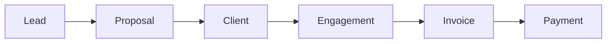

# Mermaidman Language — kernel semantics and examples

**Status:** draft skeleton, 2026-10-17. Sections marked *TODO* are to be filled during Phase 0 of [`PLAN.md`](PLAN.md).
**Rule of the document:** every construct here must be expressible in the kernel of §2. If an example needs something else, the kernel is wrong and this document changes first.

## 1. Two vocabularies

**The language people think in** (and that appears in source, UI and agent prompts):

| Word | Meaning |
| --- | --- |
| Thing | something with persistent identity |
| Fact | `subject key value` plus metadata |
| Type | a shape facts are checked against; additive, not exclusive; no inheritance |
| Expr | a pure calculation over values, facts and relations |
| Rule | logic that derives facts or values from facts; pure |
| Query | a question of the world; pure; returns a Table |
| Action | an effectful operation; produces a Change plus external effects |
| Change | a value describing additions and removals of facts |
| View | a query plus a renderer |

Runtime words users already know: **Commit**, **Branch**, **Source**.

**Engine vocabulary** (never surfaces as product ontology): UID, FactId, AST, IR, Index, Transaction, Patch, Provenance, Renderer, Scene, Materialized View.

Renames from earlier drafts: Entity→Thing, Statement→Fact, RelationInstance→Thing with role facts, WorldPatch→Change, Revision→Commit, Scenario→Branch, Policy→Rule used as guard, ViewSpec→View, Lens→view modifier, Surface→Renderer, Provenance→Source, DrillTarget→runtime route, NavigationFrame→runtime state.

## 2. Core IR

Five concepts plus a commit log. Everything else desugars to these.

```ts
Value =
    Null | Bool | Number | Text | Date | Time | Duration
  | Money<Currency> | Quantity<Unit>
  | Ref                       // a Thing
  | List<Value> | Set<Value> | Record<string, Value> | Table<Record>

Fact {
  id:      FactId
  subject: Ref
  key:     Symbol
  value:   Value
  meta:    Meta               // source, confidence, state, valid_from/to, recorded_at
}

Expr =
    Literal | Lookup | Match | Filter | Traverse | Aggregate | Call

Change =
    CreateThing(Ref)
  | AddFact(Fact)
  | RemoveFact(FactId)

Commit { id, parents: [CommitId], changes: [Change], author, at, message? }
```

Formal reading:

```
World(C)   = apply(ancestry(C).changes)      with bitemporal resolution over meta
Branch     = pointer to Commit
Query      = World → Table
Rule       = Facts → DerivedFacts
Expr       = World × Scope → Value
View       = World → Scene
Action     = World × Input → Change + Effects
```

Properties and graph edges are the same thing: `robin name "Robin"` and `xzcute owns mermaidman` are both facts; the second has a `Ref` value.

Stored vs derived is a first-class distinction: `supplier.rating = 8.2` is a fact; `supplier.exposure = sum(open_pos.amount)` is an Expr. The system always knows which is which.

## 3. Desugaring

```
thing robin: Person { name: "Robin" }
  ⇒ CreateThing robin
    AddFact robin type Person
    AddFact robin name "Robin"

xzcute owns mermaidman
  ⇒ AddFact xzcute owns mermaidman

engagement.fee = INR(200000)
  ⇒ AddFact engagement fee INR(200000)

derive outstanding = total - sum(payments.amount)
  ⇒ Rule producing a value; evaluated, never stored

on invoice becomes overdue { run chase_overdue(invoice) }
  ⇒ event subscription + rule + action invocation

rule can_issue_po(actor, po) if { actor == robin }
action issue_po(po) { require can_issue_po(current_actor, po) … }
  ⇒ policy is a rule used as a guard; no Policy primitive

thing procurement_agent: Agent
procurement_agent can_use request_quote
  ⇒ agents are Things with facts; no Agent primitive
```

Relationships with properties are Things, not a second relation ontology:

```
thing client_a_engagement: Engagement {
  provider: xzcute
  client:   client_a
  status:   active
  fee:      INR(200000)
}
```

## 4. Mermaid surface and `%% @mm` directives

A Mermaidman document is valid Mermaid topology plus comment directives. Mermaid ignores every `%%` line.



```text
%% @mm v1
%% @mm:thing Lead       {"uid":"t_lead","type":"consulting.Lead"}
%% @mm:thing Proposal   {"uid":"t_prop","type":"consulting.Proposal"}
%% @mm:thing Client     {"uid":"t_cli","type":"business.Organization"}
%% @mm:thing Engagement {"uid":"t_eng","type":"consulting.Engagement"}
%% @mm:thing Invoice    {"uid":"t_inv","type":"finance.Invoice"}
%% @mm:thing Payment    {"uid":"t_pay","type":"finance.Payment"}
%% @mm:edge  e1 {"eid":"e_lp","source":"Lead","target":"Proposal","key":"next"}
%% @mm:view  default {"renderer":"mermaid.flowchart"}
%% @mm:layout default Lead {"x":40,"y":120}
```

Directive families (v1):

| Directive | Layer | Carries |
| --- | --- | --- |
| `@mm v1` | header | schema version |
| `@mm:thing <id> {…}` | world | uid, type(s) |
| `@mm:fact <id> {…}` | world | scalar/ref facts on the thing |
| `@mm:edge <eid> {…}` | world | eid, source, target, key |
| `@mm:rule <name> {…}` | world | rule body (Phase 5) |
| `@mm:action <id>.<verb> <ref>` | effect | action binding (Phase 6+) |
| `@mm:bind <id> <provider.kind>` | effect | external binding (Phase 6+) |
| `@mm:view <name> {…}` | visual | renderer, filters |
| `@mm:layout <view> <id> {…}` | visual | x, y, w, h |
| `@mm:style <view> <id> {…}` | visual | fill, stroke, … |
| `@mm:drill <Type> -> <view>` | visual | drill routing |
| `@mm:ai <key> {…}` | meta | provenance of AI edits |

Conventions: JSON bodies only in new writes; keys emitted in canonical order; edge directives pair by `(source, target)` Mermaid ids; `@node:`/`@edge:` and loose `{ x: 1 }` are parsed for one major version then dropped.

Fact metadata (annotations in text form; JSON in directives):

```
xzcute controls mm_repo        @source github  @seen 2026-10-11
client_a possible_retainer xzcute
                               @source notebook_photo  @confidence 0.71  @state inferred
robin director_of xzcute       @from 2026-10-01
```

## 5. `.world` text form (not final syntax)

Readable even to someone who did not build Mermaidman. Used for types, rules, views; Mermaid remains the preferred form for topology.

```
type Company
type Product
type Repository
type Engagement {
    provider: Company
    client:   Company
    status:   Status
    fee:      Money?
}

thing xzcute:     Company    { name: "Xzcute Technologies Private Limited" }
thing mermaidman: Product    { name: "MermaidMan" }
thing mm_repo:    Repository { name: "devrobinransom/mermaidman" }

xzcute  owns_ip    mermaidman
xzcute  controls   mm_repo
mm_repo implements mermaidman

rule external_client(client) if {
    e: Engagement
    e.provider == xzcute
    e.client   == client
    e.status   == active
}

derive outstanding(invoice) = invoice.total - sum(invoice.payments.amount)

view clients {
    from business.Organization where external_client(this)
    as grid
    columns name, retainer, outstanding, repos
}

view project_flow { from project_dependencies(jub) as mermaid.flowchart }
```

Datalog semantics underneath (semi-naive, recursive):

```
depends_on_transitively(A, C) :- depends_on(A, B), depends_on_transitively(B, C).
```

Effects are explicit on actions (Phase 6+):

```
action chase_invoice(invoice)
    effects [email, write]
    require can_chase(current_actor, invoice)
{ … }
```

## 6. Laws

1. Standard Mermaid stays meaningful.
2. Topology is human-readable; Mermaidman-only data lives in comments.
3. Stable identity (`uid`/`eid`) survives label, layout and rename.
4. Source mutations are deterministic and diff-friendly.
5. The world language is pure; effects live only in Actions.
6. Rules never mutate. Actions never derive.
7. AI reads and proposes Changes; it never writes the world directly.
8. One expression language across grid, graph, rules, views and metrics.
9. A new kernel primitive is admitted only after proving it cannot be expressed with Thing, Fact, Type, Expr, Rule, Query, Action, Change or View.

## 7. Example corpus (Phase 0 deliverable)

Each example must compile to §2 without new primitives. Target 20–30. Check each off when written and round-trip tested in `fixtures/worlds/`.

### 7.1 xZcute org map (primary dogfood)
- [ ] E01 Company, products, repositories, IP ownership
- [ ] E02 Client engagements with retainer vs project fee
- [ ] E03 Inferred retainer with `@confidence`, then human `confirm`
- [ ] E04 Engagement controls several repositories; repository may use xZcute IP
- [ ] E05 Drill: home → clients → engagement → repository architecture
- [ ] E06 Grid of clients with derived `outstanding`; same query `as graph`

### 7.2 SAR JUB-018 procurement (stress test)
- [ ] E07 Drawing → BOM item → Material → Supplier → RFQ → Quote → PO
- [ ] E08 Money and Quantity units; `17.5m + 12kg` rejected
- [ ] E09 BOQ, Procurement, Cashflow, Schedule as four views over one PO
- [ ] E10 `derive exposure(supplier) = sum(open_pos.amount)`
- [ ] E11 Branch `vendor_b_option`: supplier change, cost delta, delivery delta, compare (Phase 6+ semantics; written now to validate kernel)
- [ ] E12 Overdue invoice rule → `chase_invoice` action with `email` effect

### 7.3 Consulting engagement lifecycle
- [ ] E13 `Prospect --> Qualified --> Proposal --> Won/Lost --> Engagement` recognized as a state machine
- [ ] E14 Board view grouped by stage from the same facts
- [ ] E15 Guard: only `robin` may accept a proposal

### 7.4 Mermaidman's own repo architecture
- [ ] E16 Crates, apps, dependencies as Things and `depends_on` facts
- [ ] E17 `depends_on_transitively` recursive rule
- [ ] E18 Subgraphs as scopes (`web`, `core`, `tauri`)

### 7.5 Generated CRM (agent output target)
- [ ] E19 `type Account / Contact / Opportunity`, `active_opportunity` rule, `pipeline` kanban view
- [ ] E20 Agent-proposed Change rendered as ghost, accepted into a commit

### 7.6 Kernel edge cases
- [ ] E21 Thing with no type, typed later, no migration
- [ ] E22 Thing with several additive types
- [ ] E23 Rename a field; derived expressions keep working (stable refs, not names)
- [ ] E24 Fact validity window (`@from` / `@valid_from`) and point-in-time query
- [ ] E25 Event as a Thing (`PaymentReceived`) vs a fact change
- [ ] E26 Free-grid scratch cells coexisting with bound rows (Phase 4+)
- [ ] E27 Legacy `@node:` document migrates to `@mm v1` byte-stably

## 8. Open questions

- *TODO* Symbol namespace: `consulting.Lead` vs `Lead` with `use consulting`.
- *TODO* Bitemporal defaults: is `recorded_at` always commit time?
- *TODO* Merge policy syntax on fields (`merge conflict | union | lww`).
- *TODO* Where `Table` ends and `View` begins for renderers that edit.
- *TODO* Rule syntax for users: block form vs Datalog form (plan recommends block form).
